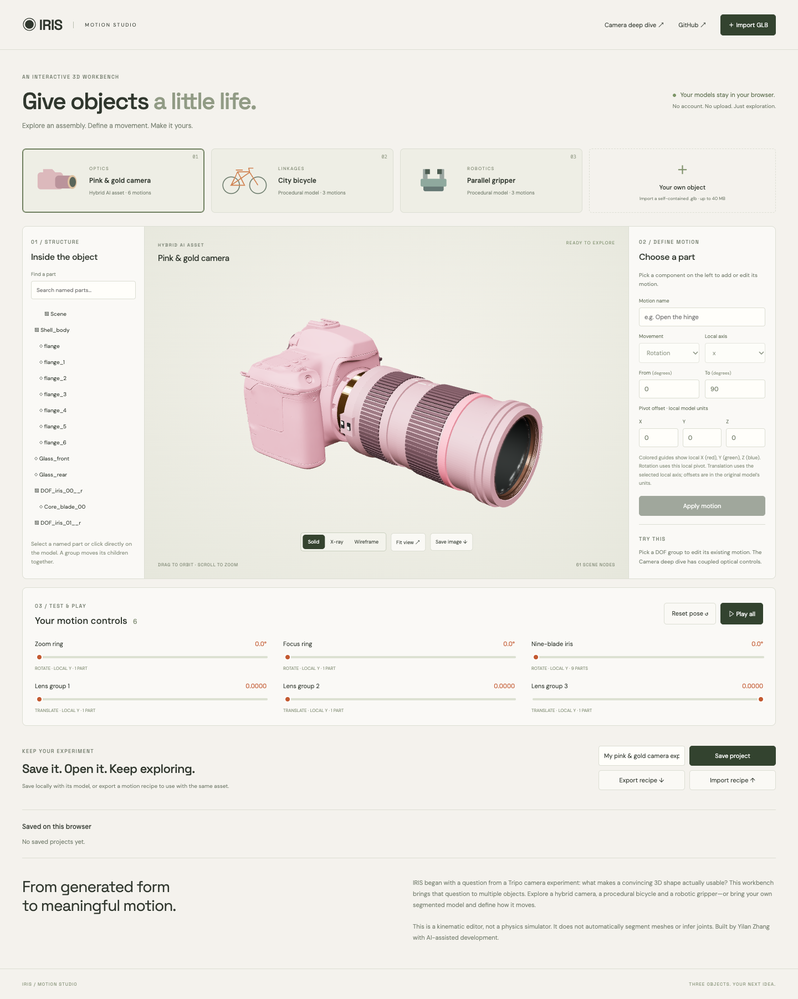

# IRIS · Motion Studio

**A browser workbench for turning static 3D assets into interactive objects.** Explore three assemblies, import your own GLB, define part motion, and save a reusable experiment.

[Open Motion Studio](https://yilan-zhang.github.io/iris-camera-lab/) · [Camera deep dive](https://yilan-zhang.github.io/iris-camera-lab/camera.html) · [Product brief](docs/product.md)



## What you can do

- **Choose an asset:** a pink-and-gold hybrid camera, procedural city bicycle, or procedural parallel gripper. These are three different articulated assemblies, not cosmetic variants.
- **Bring your own model:** import a self-contained, uncompressed GLB up to 40 MB. Files are parsed locally and are not uploaded.
- **Inspect structure:** search the scene hierarchy or click a mesh. Selected components have bounds and local-axis guides. Groups retain their existing parent-child relationships.
- **Define motion:** choose rotation or translation; set a local axis, numeric limits and rotation pivot. Edit or remove controls, including built-in motions.
- **Test:** move individual sliders or animate all channels. Reset returns each channel to zero when its range includes zero, otherwise the closest permitted endpoint.
- **Inspect appearance:** solid, X-ray and wireframe modes; orbit, fit the view, or export a PNG.
- **Save projects:** IndexedDB stores motion settings and, for an imported asset, the GLB itself. Reload the page and reopen the saved project without reselecting the file.
- **Exchange recipes:** export/import validated JSON configurations. A model fingerprint prevents applying a recipe to the wrong asset.
- **Explore optics:** the separate camera page preserves coupled lens motion, a nine-blade iris, exploded views, presets, illustrative optics and shareable URLs.

## Quick start

```sh
npm ci
npm run dev
```

Node.js 22+ recommended. Open the printed local URL.

Try **City bicycle → search “Steering” → choose the group → change its rotation range → Apply motion**. Move the corresponding slider, name the project, and save. For a new GLB, select a mesh/group and add a motion using the same workflow.

```sh
npm test
npm run test:e2e
npm run build
npm run preview
```

Browser checks use installed macOS Chrome by default. Set `CHROME_PATH` for another installed Chromium executable. The dev server should be running on port 4318, or set `TEST_URL`. The build includes both `index.html` and `camera.html`.

## How it works

**Stack:** Three.js, JavaScript ES modules, HTML/CSS, Vite, IndexedDB, Node test runner and Playwright. Static deployment on GitHub Pages; no application server, runtime AI API or account system.

The motion engine indexes the imported scene deterministically and retains every node’s rest position and quaternion. A channel targets one or more nodes, specifies a local axis and bounded range, and applies its transform from rest on every frame. Rotation around an offset pivot uses a compensating translation so the pivot stays fixed. Translation follows the rest quaternion’s transformed local axis. Repeated updates therefore do not accumulate drift.

Existing parent-child relationships propagate motion through groups. The bicycle’s front wheel can spin while its parent steering assembly turns. The gripper’s left/right local axes face opposite directions, producing outward finger travel. This is kinematic scene-graph control, not inverse kinematics or a physics engine.

| Module                                      | Responsibility                                                                  |
| ------------------------------------------- | ------------------------------------------------------------------------------- |
| `src/studio.js`                             | Asset switching, viewer, editor, picking, imports, project lifecycle            |
| `src/motion.js`                             | Scene indexing, validated motion recipes, pivot transforms, GLB preflight       |
| `src/assets.js`                             | Original procedural bicycle/gripper geometry and motion definitions             |
| `src/storage.js`                            | IndexedDB project transactions                                                  |
| `src/rig.js`, `src/main.js`, `src/state.js` | Specialized camera lab and its optical illustrations                            |
| `tests/`                                    | Transform invariants, invalid input handling, persistence and browser workflows |

Built-in recipes use stable asset identifiers. Imported models use SHA-256 of the GLB bytes. Recipes are data only; imported labels render as text. GLBs with external resource URLs are rejected to keep model loading self-contained. Compressed Draco/Meshopt/KTX2 assets need an uncompressed export for this version.

## Scope and limitations

- Motion requires existing separate meshes or groups. IRIS does **not** automatically segment a single mesh, infer joints, create skin weights, or change the model hierarchy.
- Numeric pivots are in the original model’s local units. Rendering normalizes each asset for viewing without changing those authored units.
- Each node has at most one motion channel. A channel can target several nodes, as with the camera iris or bicycle wheels. The editor preserves grouped targets when editing an existing channel.
- Existing animation clips are not played; procedural channels drive the pose. Skinning and unusual material extensions have not been exhaustively tested.
- There is no collision detection, dynamic simulation, physical optics or calibrated depth of field. Exploded views and optical readouts belong to the camera-specific page.
- Saved projects stay in this browser and origin. Clearing site data removes them; there is no cloud backup or cross-device synchronization. Export recipes separately and retain original model files.
- WebGL is required. Large models can be slow on low-powered devices. Tested in desktop Chrome and a mobile-sized Chrome viewport, not a physical phone.
- Google Fonts may be fetched for typography; imported model bytes are not sent to a service. No analytics or account system.

## Origin and authorship

Project direction and the original Tripo camera exploration are by **Yilan Zhang (Winnie)**. The camera combines generated appearance with an articulated mechanical core from her earlier exploration. The bicycle and gripper are procedural demonstration assets created for this edition, not prior personal experiences or externally sourced research assets.

The standalone web applications, generic motion editor, procedural examples, tests and documentation were developed with **Codex assistance**. This is a personal project, not a hackathon entry. See [asset provenance](docs/asset-provenance.md) and [validation notes](docs/validation.md).

## Deployment and license

`npm run build` emits a static `dist/` with relative asset paths. GitHub Actions runs the unit tests and deploys to GitHub Pages. A Vercel configuration is included but Vercel deployment is not claimed.

Application source and procedural models are MIT licensed. The original GLB has separate terms described in [asset provenance](docs/asset-provenance.md).
